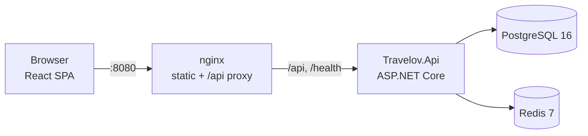

# Travelov

A mini hotel-booking web app in the spirit of Traveloka — built as a portfolio project targeting
.NET entry/mid-level roles. Search hotels, check per-date availability, book a room, pay through a
sandbox gateway, and manage everything from an admin dashboard.

> **Screenshot placeholder** — `docs/screenshot-home.png` (add a capture of the home/search page here).

## Tech stack

| Layer     | Technology |
| --------- | ---------- |
| Backend   | .NET 8, ASP.NET Core (controller-based), EF Core, PostgreSQL 16, Redis 7, Serilog, Swagger/OpenAPI, JWT auth, rate limiting |
| Frontend  | React 18, TypeScript, Vite 5, Tailwind CSS 3, React Router 6, TanStack Query 5, Axios |
| Infra     | Docker & Docker Compose (nginx-served SPA + API + Postgres + Redis) |

## Architecture



The backend follows a pragmatic Clean Architecture split:

- `Travelov.Domain` — entities, enums, and booking/pricing rules (e.g. `BookingPricing.TaxRate = 0.11`).
- `Travelov.Application` — use cases, DTOs, abstractions.
- `Travelov.Infrastructure` — EF Core persistence, identity/JWT, seeding.
- `Travelov.Api` — controllers, filters, middleware, composition root.

The frontend is a single-page app under `frontend/` that talks to the API over `/api`.

## Getting started (Docker — recommended)

Requires Docker. From the repository root:

```bash
docker compose up -d --build
```

This builds and starts four services:

| Service | URL / port | Notes |
| ------- | ---------- | ----- |
| `web`   | http://localhost:8080 | nginx serving the built SPA, proxying `/api` and `/health` |
| `api`   | http://localhost:5080 | ASP.NET Core API (Swagger at `/swagger`) |
| `db`    | localhost:5432 | PostgreSQL |
| `redis` | localhost:6379 | Redis |

Demo data (hotels, inventory, accounts) is seeded automatically on first API startup.

### Demo credentials

| Role  | Email                | Password   |
| ----- | -------------------- | ---------- |
| User  | `user@travelov.test` | `User123!` |
| Admin | `admin@travelov.test`| `Admin123!`|

## Running the frontend in dev mode

Run the stack (or just the API) with Docker, then start Vite for hot reload:

```bash
cd frontend
npm install
npm run dev
```

Vite serves at http://localhost:5173 and proxies `/api` and `/health` to the API on
`http://localhost:5080`.

Useful scripts:

```bash
npm run dev      # dev server with HMR
npm run build    # type-check (tsc -b) + production build
npm run preview  # preview the production build
```

## API overview

| Area      | Endpoints |
| --------- | --------- |
| Auth      | `POST /api/auth/register`, `POST /api/auth/login`, `POST /api/auth/refresh`, `POST /api/auth/logout`, `GET/PUT /api/auth/me`, `POST /api/auth/change-password` |
| Hotels    | `GET /api/hotels` (search), `GET /api/hotels/facilities`, `GET /api/hotels/{id}`, `GET /api/hotels/{id}/reviews` |
| Bookings  | `POST /api/bookings`, `GET /api/bookings`, `GET /api/bookings/{id}`, `POST /api/bookings/{id}/cancel` |
| Payments  | `POST /api/payments/simulate` (sandbox) |
| Reviews   | `POST /api/reviews` |
| Admin     | `GET /api/admin/stats`, `/api/admin/hotels`, `/api/admin/inventory`, `/api/admin/bookings`, plus hotel/room-type/facility CRUD |
| Health    | `GET /health` |

Interactive docs are available at http://localhost:5080/swagger while the API runs in Development.

### Booking lifecycle

`PendingPayment` → (`Confirmed` on successful sandbox payment) → `Completed`, or `Expired` /
`Cancelled`. Payment simulation is idempotent: replaying a callback returns `alreadyProcessed: true`.

## Smoke test

An end-to-end happy-path script exercises search → login → hotel detail → booking → payment →
booking history → admin checks:

```bash
API=http://localhost:5080 ./scripts/smoke-test.sh
```

## Project structure

```
Travelov/
├── backend/            # .NET solution
│   ├── src/            # Domain, Application, Infrastructure, Api
│   ├── tests/          # Travelov.UnitTests, Travelov.IntegrationTests
│   └── Dockerfile
├── frontend/           # React + Vite SPA (Dockerfile + nginx.conf)
├── scripts/            # smoke-test.sh
├── docker-compose.yml
└── prd.md              # product requirements
```

## Notes & limitations

- Payments use a **sandbox** simulator — no real gateway is integrated.
- Seeded inventory covers a rolling window of dates; availability outside it returns `null`.
- Prices are stored and displayed in IDR; tax is a flat 11% (PPN).
